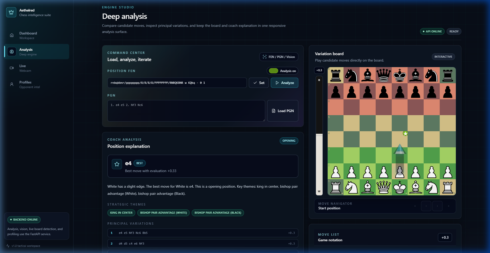
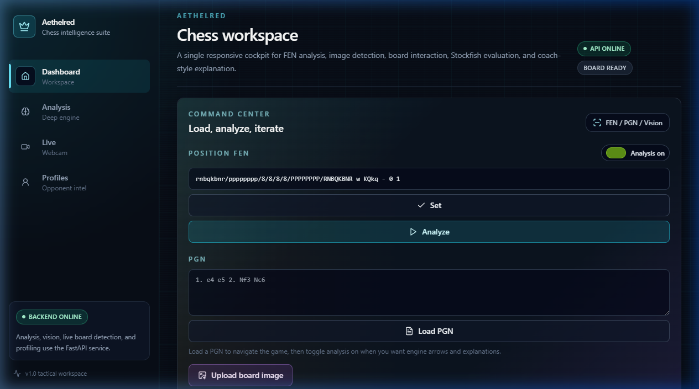
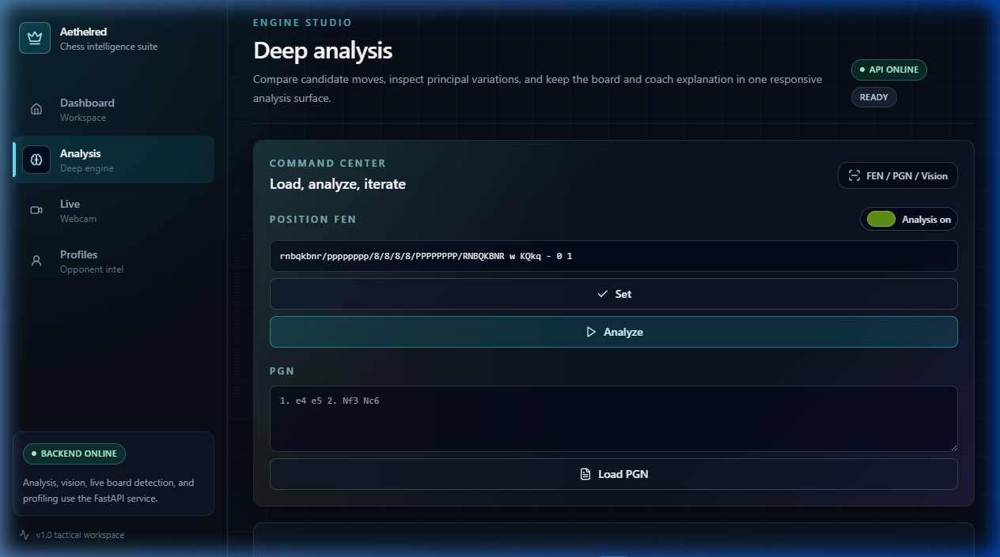
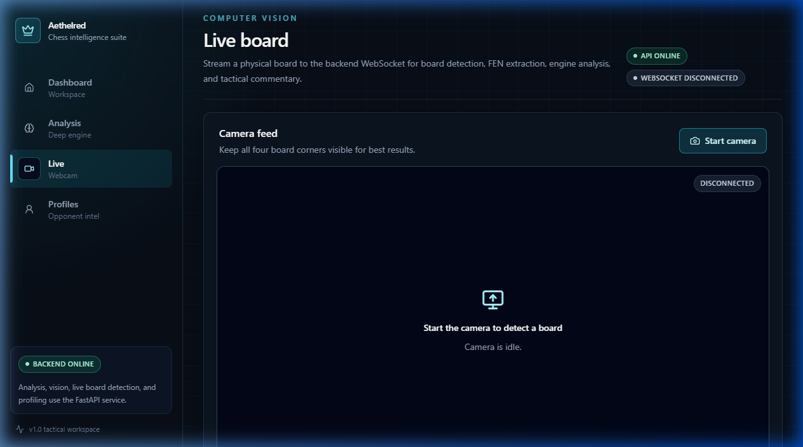
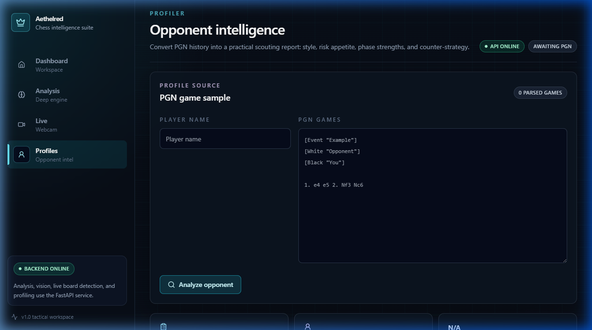

<div align="center">
  

  <br />
  <br />

  <h1>🏰 Checkmate (Aethelred)</h1>
  
  <p>
    <b>The Ultimate Vision-Based Chess Strategy Analyzer & Opponent Profiler</b>
  </p>
  
  <p>
    <a href="#-quickstart"></a>
    <a href="#-architecture"></a>
    <a href="#-tech-stack"></a>
    <a href="LICENSE"></a>
  </p>

  <p>
    <sub>Built with <strong>Next.js 14</strong>, <strong>FastAPI</strong>, <strong>OpenCV</strong>, <strong>PyTorch</strong>, and <strong>Stockfish 16 (NNUE)</strong></sub>
  </p>
</div>

---

## 🌟 Premium Introduction

**Checkmate** (internally known as *Aethelred*) is not just another chess engine. It is a full-stack, enterprise-grade chess intelligence platform designed to bridge the gap between silicon perfection and human understanding.

By leveraging a custom **Computer Vision (CV)** pipeline, Checkmate can "see" a chessboard from a webcam feed or screenshot, accurately digitize the board state using deep learning, and feed it into a **Stockfish 16 NNUE** engine. But it doesn't stop there. Our **Explainable AI (XAI)** translates cold engine evaluations into natural language, coaching you exactly like a grandmaster would.

---

## 🧭 Project Philosophy

We believe that chess engines are incredible tools, but they speak the language of numbers (`+1.45`), not the language of humans. 

**Our core tenets:**
1. **Frictionless Input:** Getting a board state into an engine shouldn't require manual FEN string construction. Just point a camera or paste a screenshot.
2. **Transparent Analysis:** Don't just tell the user *what* the best move is; explain *why* it's the best move using strategic and tactical motifs.
3. **Psychological Profiling:** Chess is played against humans. Analyze game histories to build psychological opponent profiles (Aggressive, Defensive, Positional).

---

## 📸 UI / UX Showcase

<div align="center">
  <table>
    <tr>
      <td align="center">
        <b>Main Dashboard</b><br>
        
      </td>
      <td align="center">
        <b>Deep Analysis</b><br>
        
      </td>
    </tr>
    <tr>
      <td align="center">
        <b>Live Webcam Feed</b><br>
        
      </td>
      <td align="center">
        <b>Opponent Profiler</b><br>
        
      </td>
    </tr>
  </table>
</div>

### Beautifully Crafted Interface
* **Glassmorphism Design:** Dark tactical theme with sleek, semi-transparent frosted glass panels and neon cyan accents.
* **Framer Motion Animations:** Buttery smooth page transitions and micro-interactions.
* **Live Heatmaps:** Visual square control mapping layered dynamically over the board.

---

## ✨ Enterprise Features

### 👁️‍🗨️ 1. Computer Vision Pipeline
Our vision system seamlessly extracts FEN strings from messy real-world images.
* **YOLOv8 Object Detection:** Fast, accurate bounding boxes for the 64 squares.
* **Perspective Warping:** Auto-rectifies skewed camera angles using OpenCV transformations.
* **ResNet18 Piece Classification:** A deep convolutional neural network trained to recognize the 12 piece types (and empty squares) with high confidence.

### ♟️ 2. Deep Engine Integration
* **Stockfish 16 NNUE:** The undisputed world champion open-source engine, integrated as a highly efficient async singleton.
* **Multi-PV (Principal Variation):** Evaluates the top 3 best continuations simultaneously.
* **Tactical Threat Radar:** Instantly highlights forks, pins, skewers, and discovered attacks.

### 🧠 3. Explainable AI & Natural Language
* **Grandmaster Persona:** Translates variations into actionable English coaching.
* **Motif Recognition:** Scans for structural themes like "isolated pawns" or "outposts."
* **Move Categorization:** Beautiful visual badges for Brilliant ‼, Excellent, Good, Inaccuracy, Mistake, and Blunder ??.

### 🎭 4. Opponent Profiler
* **Playstyle Detection:** Categorizes opponents automatically.
* **Risk Tolerance Metrics:** Analyzes how often an opponent gambits or sacrifices.
* **Endgame Skill Scoring:** Tracks accuracy drops as pieces leave the board.

---

## 🏗️ Architecture Overview

Checkmate employs a highly decoupled, modular architecture modeled after elite FAANG monoliths.

<details>
<summary><strong>Click to expand Architecture Diagram</strong></summary>
<br>

```text
                        ┌──────────────────┐
                        │    Browser       │
                        │   (Next.js 14)   │
                        └────────┬─────────┘
                                 │ REST / WebSocket
                        ┌────────┴─────────┐
                        │     Nginx        │
                        │  (Reverse Proxy) │
                        └────────┬─────────┘
                                 │
                        ┌────────┴─────────┐
                        │   FastAPI        │
                        │   Backend        │
                        └──┬──┬──┬──┬──────┘
                           │  │  │  │
              ┌────────────┘  │  │  └────────────┐
              │               │  │               │
        ┌─────┴──────┐  ┌────┴──┴────┐  ┌───────┴───────┐
        │ CV Engine  │  │ Stockfish  │  │  AI Modules   │
        │  YOLOv8    │  │   (NNUE)   │  │  Explainer    │
        │  ResNet18  │  │ Singleton  │  │  Profiler     │
        │  OpenCV    │  │ Async Lock │  │  NLG Engine   │
        └────────────┘  └─────┬──────┘  └───────────────┘
                              │
                        ┌─────┴──────┐
                        │   SQLite   │
                        │ PostgreSQL │
                        └────────────┘
```
</details>

---

## 💻 Tech Stack

| Layer | Technologies Used |
| :--- | :--- |
| **Frontend Framework** | Next.js 14 (App Router), React 18 |
| **Styling & UI** | Tailwind CSS, Framer Motion, Lucide Icons |
| **Chess Board** | `react-chessboard`, `chess.js` |
| **Backend API** | Python 3.11, FastAPI, Uvicorn, Pydantic |
| **AI / Machine Learning**| PyTorch, Ultralytics (YOLO), OpenCV, Scikit-Learn |
| **Engine Core** | Stockfish 16 (AVX2), `python-chess` |
| **Database** | SQLite (Local), SQLAlchemy (Async), Alembic |

---

## 📂 Folder Structure

The repository is organized as a clean monorepo, keeping the backend and frontend tightly synchronized yet physically decoupled.

```text
Checkmate/
├── backend/                  # Python FastAPI application
│   ├── app/                  # Core application logic
│   │   ├── ai/               # Explainability & NLG engines
│   │   ├── api/              # REST and WebSocket routers
│   │   ├── chess_engine/     # Stockfish async wrappers
│   │   ├── cv/               # Computer Vision pipelines
│   │   └── models/           # SQLAlchemy & Pydantic schemas
│   ├── ml/                   # Model training scripts & datasets
│   └── stockfish/            # Bundled engine binaries
├── frontend/                 # Next.js 14 React application
│   ├── src/app/              # Next.js App Router pages
│   ├── src/components/       # Reusable UI, Chess, & Layout elements
│   ├── src/features/         # Domain-specific feature modules
│   └── src/lib/              # Utilities, hooks, and API clients
├── nginx/                    # Production reverse proxy configs
└── docker-compose.yml        # Full-stack container orchestration
```

---

## 🚀 Quickstart & Installation

### 1. Prerequisites
Ensure you have the following installed on your machine:
- **Node.js 20+** (for frontend)
- **Python 3.11+** (for backend)
- **Git**

### 2. Environment Setup
Clone the repository and prepare your environment variables.
```bash
git clone https://github.com/your-username/checkmate.git
cd checkmate
cp .env.example .env
```
*(No need to manually install Stockfish on Windows, the binary is already bundled in the repo!)*

### 3. Start the Backend (FastAPI)
```bash
cd backend
python -m venv venv

# Activate Virtual Environment
# Windows: .\venv\Scripts\Activate.ps1
# Mac/Linux: source venv/bin/activate

pip install -r requirements.txt
uvicorn app.main:app --reload --host 0.0.0.0 --port 8000
```
*(The backend will run on `http://localhost:8000`)*

### 4. Start the Frontend (Next.js)
Open a new terminal window:
```bash
cd frontend
npm install
npm run dev
```
*(The stunning UI will be available at `http://localhost:3000`)*

---

## 🐳 Docker Deployment

Checkmate is fully containerized and production-ready for deployment anywhere Docker runs.

```bash
# Build and spin up the entire stack (Postgres + FastAPI + Next.js + Nginx)
docker-compose up --build -d

# Check live logs
docker-compose logs -f
```

---

## ⚡ Performance Optimizations

1. **Stockfish Singleton Pattern**: Instead of spawning a new 750MB process per API request, the FastAPI backend manages a centralized, async-locked singleton instance of Stockfish.
2. **WebSockets for Video**: The `/ws/live` endpoint processes webcam streams at 5 FPS via binary WebSockets, drastically reducing HTTP overhead compared to traditional polling.
3. **Next.js Server Components**: Heavy rendering tasks are offloaded to the server to maintain peak client-side animation performance.

---

## 🤝 Contributing

We welcome contributions from the open-source community! 

1. **Fork** the repository.
2. **Create a branch**: `git checkout -b feature/your-feature`
3. **Commit changes**: `git commit -m 'Add some feature'`
4. **Push**: `git push origin feature/your-feature`
5. **Open a Pull Request**.

Ensure your code passes all linting (`npm run lint` / `python -m py_compile`) before submitting.

---

## 📜 License

Checkmate is proudly open-source and released under the **MIT License**. See the [LICENSE](LICENSE) file for more information.

<br />

<div align="center">
  <sub>Built with ♔ by the Aethelred Team. Where silicon perfection meets human understanding.</sub>
</div>
